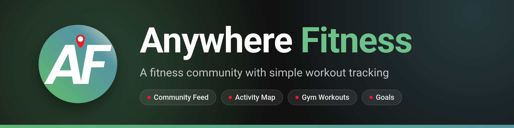

---

Anywhere Fitness is a health and fitness community app for people who want to share their fitness journey, plan gym workouts, and set personal goals. It was built for the Code Overflow 2023 hackathon, where it placed third.

It runs the Next.js App Router code on Vinext with MUI, deployed as a Cloudflare Worker backed by D1 and R2.

## Features

- **Community Feed**: Share posts with a message and an optional cover image.
- **Advertisements**: Publish fitness listings with a title and description.
- **Activity Map**: Pick an activity on a Mapbox map of your surroundings.
- **Gym Workouts**: Build a workout list from exercises grouped by muscle group, with linked videos.
- **Goals**: Add and remove personal fitness goals.
- **Accounts**: Register, sign in, and change your name and avatar.

## Tech Stack

- [Vinext](https://github.com/cloudflare/vinext) for running the Next.js App Router on Vite.
- [React](https://react.dev) and [MUI](https://mui.com/material-ui) for the user interface.
- [Mapbox GL JS](https://docs.mapbox.com/mapbox-gl-js) for the activity map.
- [Drizzle ORM](https://orm.drizzle.team) for the database schema, queries, and migrations.
- [Cloudflare Workers](https://developers.cloudflare.com/workers) for hosting, with D1 for data and R2 for uploads.
- [Bun](https://bun.sh) for dependencies, linting, formatting, type checking, and tests.

## Getting Started

### Prerequisites

- [Bun](https://bun.sh) 1.4 or newer
- [Node.js](https://nodejs.org) 24 or newer
- [Just](https://just.systems)

### Setup

1. Copy `.env.template` to `.env` and fill in the Mapbox access token.

   ```sh
   cp .env.template .env
   ```

2. Install dependencies and apply the local D1 migrations.

   ```sh
   just setup
   ```

3. Start the development server and open http://localhost:3000.

   ```sh
   just start
   ```

## Documentation

- [Cloudflare Development](docs/guides/cloudflare.md)

## License

Licensed under the [MIT License](LICENSE).
